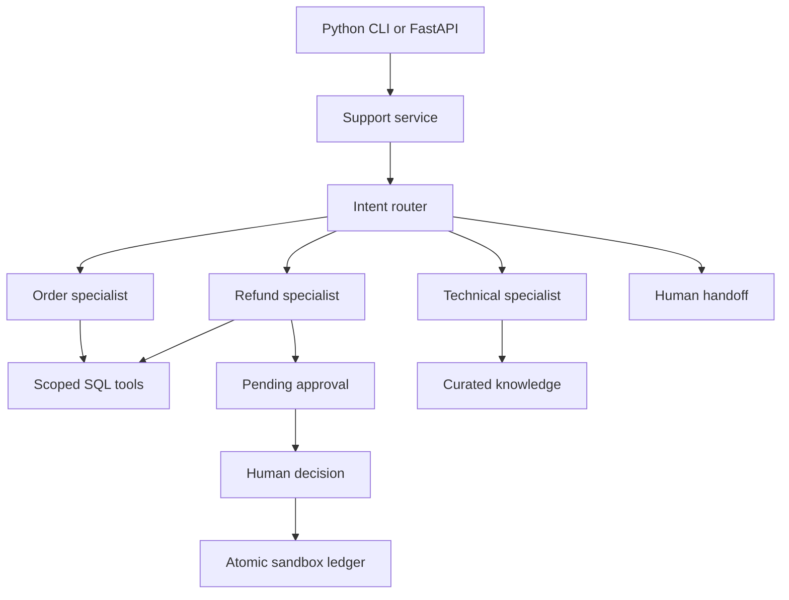

# Architecture

The core is a Python package independent of HTTP and of a model provider. A typed, bounded workflow selects an order, refund, technical-support, or handoff specialist. Specialists receive a small tool layer; that layer has no approval operation.

SQLite provides a zero-setup local SQL database through Python's standard library. The optional SQLAlchemy adapter uses PostgreSQL with the same named-parameter repository queries. PostgreSQL locks the ticket/order/approval rows needed for a state transition; local SQLite serializes writes with BEGIN IMMEDIATE. No new frontend language is introduced for deployment convenience.

The optional Groq router makes at most one JSON-mode request per turn. Its output is validated and its order ID must be present in the customer's own conversation. Deterministic server policy decides eligibility. Operational replies come from tool results; the LLM never receives an execute-refund tool.

Conversations, run results, node traces, approvals, and refund records are durable. A completed retry returns its saved response. A failed transaction rolls back all its writes. This release executes one short, bounded turn in a database transaction; it does not implement autonomous agents, streaming responses, or a background queue.

## Access model

The CLI runs as the local operator. FastAPI uses a bearer operator token and a configured workspace; the client cannot choose another workspace. Selecting a sandbox customer is an operator simulation, not proof of customer identity. Add a verified customer session before exposing a customer-facing channel. Do not expose the generated docs or a local development service publicly without proper service hosting and identity controls.

## Extending safely

Before real refunds, add a merchant/payment adapter, provider idempotency, webhook reconciliation, amount/currency validation, and independent operator roles. Before long-running workflows, move model calls outside database lock windows and introduce a durable queue with leases. Retain the same policy and authorization tests.
